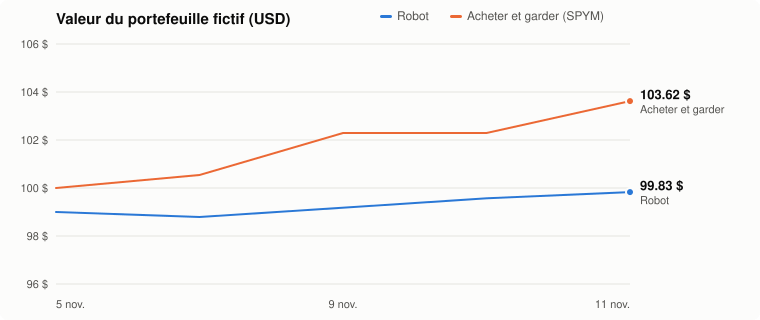

# Robot de trading hybride (règles + IA) — portefeuille fictif sur GitHub Actions

<!-- RAPPORT:DEBUT -->
## 📊 Rapport

_Mis à jour le 2026-11-11 · portefeuille fictif de départ : 100.00 $_



| | Valeur | Rendement |
|---|---:|---:|
| **Robot** | 99.83 $ | -0.17% |
| Acheter et garder (SPYM) | 103.62 $ | +3.62% |
| **Écart** | -3.79 $ | |

Liquidités : 50.00 $ · Frais simulés payés : 1.00 $

**Titres détenus**

| Titre | Quantité | Prix d'achat moyen |
|---|---:|---:|
| SCHD | 1.3834 | 35.42 $ |

**Dernières transactions**

| Date | Titre | Action | Montant | Raison |
|---|---|---|---:|---|
| 2026-11-05 | SCHD | Achat | 49.00 $ | tendance haussière, RSI non suracheté + IA +0.15 |

<!-- RAPPORT:FIN -->

> ⚠️ Outil expérimental et éducatif. Le robot joue avec **100 $ virtuels** aux vrais prix
> du marché : aucun courtier, aucun argent réel. Ses résultats passés ne garantissent rien.

Le robot tourne seul sur GitHub chaque jour de bourse, vers 10 h 35 à Montréal
(11 h 35 l'été). Ton ordinateur n'a pas besoin d'être allumé, et aucun compte de courtage n'est nécessaire.

## Comment il décide

1. **Règles** : il achète seulement si le prix est au-dessus de sa moyenne sur 50 jours,
   elle-même au-dessus de la moyenne sur 200 jours, et si le RSI est sous 70.
   Il vend quand la tendance devient baissière.
2. **IA (Claude)** : elle lit les nouvelles récentes du titre et donne un score de -1 à 1.
   Elle **confirme ou bloque** un achat, et peut forcer une vente si le signal est très négatif.
   Elle ne peut jamais acheter seule.
3. **Garde-fous** : max 50 % par titre, max 2 titres, stop-loss à 10 %, et pause
   d'un jour si le portefeuille a perdu 5 % depuis la veille.
4. **Test honnête** : 1 $ de frais simulés par ordre (ordre de grandeur d'un courtier canadien),
   et comparaison permanente avec « acheter et garder » un FNB S&P 500.

## Où voir les résultats

- **La page web** : https://valenux.github.io/trading-bot/ (gains et pertes du portefeuille,
  de chaque titre et de chaque vente, graphique interactif). Mise à jour après chaque exécution.
- **En haut de cette page** : le rapport (graphique, rendement, titres détenus, dernières
  transactions), mis à jour automatiquement après chaque exécution.
- **Onglet Actions** → la dernière exécution → résumé du jour (décisions, valeur du
  portefeuille comparée à « acheter et garder »).
- **`journal.csv`** : toutes les décisions, avec leur raison.
- **`portfolio.json`** : le portefeuille fictif et l'historique de sa valeur, jour par jour.

## Mise en route

### 1. Clé IA (optionnelle mais recommandée)
console.anthropic.com → **API Keys** → *Create Key*, puis ajoute quelques dollars de crédit
(le coût est de quelques sous par jour). Sans clé, le robot fonctionne avec les règles seulement.

Dans le dépôt : **Settings** → **Secrets and variables** → **Actions** →
*New repository secret* → nom `ANTHROPIC_API_KEY`, valeur = ta clé.

### 2. Premier essai
Onglet **Actions** → *Robot de trading* → **Run workflow** → Run.
Coche *dry_run* pour simplement voir l'analyse, sans rien enregistrer.

C'est tout : ensuite, il tourne seul chaque jour de semaine.

## Passer à l'argent réel plus tard

Après plusieurs semaines, compare la ligne « Robot » à « Acheter et garder ».
Si tu veux aller plus loin, l'étape suivante serait de brancher un courtier qui accepte
les résidents canadiens et offre une API, comme Interactive Brokers.
C'est une décision à prendre en connaissance de cause, pas une suite automatique.

## Personnaliser

Tout se règle dans `config.yaml` : la liste de titres (simples exemples, pas des
recommandations), le budget, les frais simulés, les limites et les seuils de l'IA.
Pour **recommencer à zéro**, supprime `portfolio.json` et `journal.csv`.
Pour **arrêter** le robot : Actions → *Robot de trading* → « ⋯ » → **Disable workflow**.

## Tests (aucune clé ni connexion nécessaire)

```bash
pip install -r requirements.txt
python tests/test_bot.py
```
